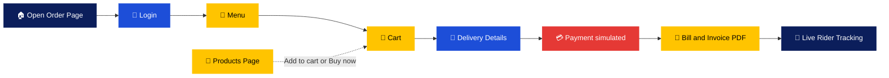

<table width="100%" align="center">
  <tr>
    <td width="20%" align="center" valign="middle">
      
    </td>
    <td width="60%" align="center" valign="middle">
      
    </td>
    <td width="20%" align="center" valign="middle">
      
    </td>
  </tr>
</table>

<div align="center">


<h3>Crispy. Golden. Pure Fun. &nbsp; 🍟 🥔 🧀</h3>


<br/>

<a href="https://shahrishabh1513-jsk.github.io/RT-Food-Frozen-Snacks/"></a>
<a href="https://shahrishabh1513-jsk.github.io/RT-Food-Frozen-Snacks/order.html"></a>
<a href="https://github.com/shahrishabh1513-jsk/RT-Food-Frozen-Snacks/blob/main/RT_FOOD_Project_Report.pdf"></a>
<a href="https://github.com/shahrishabh1513-jsk/RT-Food-Frozen-Snacks"></a>
<a href="https://github.com/shahrishabh1513-jsk/RT-Food-Frozen-Snacks/stargazers"></a>

<br/>


<br/>


</div>

<br/>

<div align="center">

[](#-live-preview)
[](#-about-the-project)
[](#-key-features)
[](#-site-pages)
[](#-order-flow)
[](#-tech-stack)
[](#-project-structure)
[](#-getting-started)
[](#-connect)

</div>

<div align="center"></div>

## 🔍 Live Preview

<div align="center">

<table width="90%">
<tr>
<td>🔴 🟡 🟢 &nbsp;&nbsp; <code>shahrishabh1513-jsk.github.io/RT-Food-Frozen-Snacks</code></td>
</tr>
<tr>
<td align="center">
<a href="https://shahrishabh1513-jsk.github.io/RT-Food-Frozen-Snacks/" target="_blank">

</a>
</td>
</tr>
</table>

<br/>

<a href="https://shahrishabh1513-jsk.github.io/RT-Food-Frozen-Snacks/" target="_blank"></a>
<a href="https://shahrishabh1513-jsk.github.io/RT-Food-Frozen-Snacks/products.html" target="_blank"></a>

</div>


<div align="center"></div>

## 📖 About The Project

<table>
<tr>
<td width="60%" valign="top">

**RT FOOD** is a fully animated, multi-page **frozen-snacks website** that turns "farm-fresh potatoes into the crunchiest fries, hash browns and snacks you can make in just three minutes."

It goes well beyond a product page: browse **50+ products**, pick a pack size, add to cart, and run a complete **order flow** — login, menu, cart, details, payment, bill and **live rider tracking** — plus recipe videos with downloadable PDF cards and an exports page with a world map.

It's built with plain **HTML, CSS and JavaScript** — no frameworks, no build step.


</td>
<td width="40%" valign="top">

| At a glance | |
|---|---|
| 🍟 **Type** | Frozen-snacks food website |
| 🛒 **Flow** | Browse → cart → pay → track |
| 🎬 **Recipes** | 33 videos + PDF cards |
| 🌍 **Exports** | World map + enquiry form |
| 🧱 **Stack** | HTML · CSS · JavaScript |

</td>
</tr>
</table>


<div align="center"></div>

## ✨ Key Features

<table>
<tr>
<td width="50%" valign="top" align="center">


<div align="left">

- 50+ frozen products — fries, hash browns, patties, cheesy pops, pizzas, momos, aloo tikki, fruit pies
- Dropdown filters
- Pack sizes with **Add to cart** / **Buy now**
- Baked snacks sold by 1 / 2 / 4 packs

</div>

</td>
<td width="50%" valign="top" align="center">


<div align="left">

- Login → menu → cart → details → payment → bill → tracking
- Coupon codes and GST handling
- QR-code payment screen *(simulated)*
- Invoice downloadable as a PDF

</div>

</td>
</tr>
<tr>
<td width="50%" valign="top" align="center">


<div align="left">

- Rider moves along a **real road route**
- OpenStreetMap geocoding + OSRM routing
- Cart, login and orders sync across open tabs
- Demo timeline compressed to about 2 minutes

</div>

</td>
<td width="50%" valign="top" align="center">


<div align="left">

- **33 recipes** with video
- Written ingredients and steps
- Downloadable **PDF recipe cards**
- Cook along in your own kitchen

</div>

</td>
</tr>
<tr>
<td width="50%" valign="top" align="center">


<div align="left">

- Exports page with a **world map** and enquiry form
- Connect page with office map, form and FAQ
- Our Culture page with a CV upload form
- Seed to Shelf story page

</div>

</td>
<td width="50%" valign="top" align="center">


<div align="left">

- Fully animated, with a "Heating up the fryer…" loader
- One design system across every page
- Pure HTML, CSS & JavaScript — no build step
- Quality badges: FSSAI, BRC, Sedex & Kosher

</div>

</td>
</tr>
</table>

<div align="center"></div>

## 📄 Site Pages

<div align="center">

| Page | What's on it | Open |
|:---:|---|:---:|
| 🏠 **Home** | Hero, bestsellers, Seed to Shelf teaser, recipes, trusted-by & order CTA | [](https://shahrishabh1513-jsk.github.io/RT-Food-Frozen-Snacks/) |
| ℹ️ **About Us** | The RT FOOD story | [](https://shahrishabh1513-jsk.github.io/RT-Food-Frozen-Snacks/about.html) |
| 🤝 **Our Culture** | Team culture, plus a CV upload form | [](https://shahrishabh1513-jsk.github.io/RT-Food-Frozen-Snacks/culture.html) |
| 🍟 **Products** | Dropdown filters, pack sizes, add to cart / buy now | [](https://shahrishabh1513-jsk.github.io/RT-Food-Frozen-Snacks/products.html) |
| 🌱 **Seed to Shelf** | From contract farms to cold storage to your plate | [](https://shahrishabh1513-jsk.github.io/RT-Food-Frozen-Snacks/seedtoshelf.html) |
| 🌍 **Exports** | World map and export enquiry form | [](https://shahrishabh1513-jsk.github.io/RT-Food-Frozen-Snacks/Exports.html) |
| 🎬 **Recipes** | 33 video recipes with text and PDF cards | [](https://shahrishabh1513-jsk.github.io/RT-Food-Frozen-Snacks/Recipes.html) |
| 🛒 **Order Now** | Login → menu → cart → details → payment → bill → tracking | [](https://shahrishabh1513-jsk.github.io/RT-Food-Frozen-Snacks/order.html) |
| 📞 **Connect** | Office map, contact form and FAQ | [](https://shahrishabh1513-jsk.github.io/RT-Food-Frozen-Snacks/connect.html) |

</div>

<div align="center"></div>

## 🧭 Order Flow



<div align="center"></div>

## 🧰 Tech Stack

<div align="center">

| Layer | Technology | Purpose |
|:---:|:---:|:---|
| **Structure** |  | Semantic multi-page markup |
| **Styling** |  | One design system, animations & light theme |
| **Logic** |  | Cart, filters, ordering, tracking & forms |
| **Storage** |  | Cart, login & orders kept in the browser |
| **Maps** | Leaflet · OpenStreetMap · OSRM | Export map, office map & route tracking |
| **Documents** | jsPDF · QR code | Recipe PDFs, invoice PDF & payment QR |
| **Media & Fonts** | YouTube · Google Fonts | Recipe videos & typography |
| **Hosting** |  | Live deployment |

</div>

<p align="center"><b>No build tools · No <code>npm install</code> · No frameworks — pure HTML, CSS and JavaScript.</b></p>

<div align="center"></div>

## 📂 Project Structure

<details>
<summary><b>Click to expand the folder structure 📁</b></summary>

```bash
RT-Food-Frozen-Snacks/
│
├── assets/image/              # Logo, product & brand images
│
├── index.html                 # Home
├── about.html                 # About Us
├── culture.html               # Our Culture (+ CV upload form)
├── products.html              # Products (filters, pack sizes, cart / buy now)
├── seedtoshelf.html           # Seed to Shelf
├── Exports.html               # Exports (world map + enquiry form)
├── Recipes.html               # Recipes (33 videos, text + PDF cards)
├── order.html                 # Order Now (login → … → live tracking)
├── connect.html               # Connect / Contact (map, form, FAQ)
├── RT_FOOD_Project_Report.pdf # Project report
│
├── css/
│   └── style.css              # One design system for every page
│
├── js/
│   ├── data.js                # Products, prices, coupons, GST, recipes, export countries
│   ├── main.js                # Loader, header/footer, cart, storage, animations
│   ├── shop.js                # Product cards + filters
│   ├── products.js / home.js / exports.js / recipes.js / order.js / forms.js
│   ├── pdf.js                 # Recipe PDF + invoice PDF
│   └── logo.js                # Logo as base64 for PDFs
│
└── README.md
```

</details>

<div align="center"></div>

## 🚀 Getting Started

<table width="100%">
<tr>
<td width="40%" valign="top">

**Option 1 — Use the live site**

No setup needed 👉 **[Open RT FOOD](https://shahrishabh1513-jsk.github.io/RT-Food-Frozen-Snacks/)**

Then try the **[Order Now](https://shahrishabh1513-jsk.github.io/RT-Food-Frozen-Snacks/order.html)** flow.

</td>
<td width="60%" valign="top">

**Option 2 — Run it locally**

```bash
git clone https://github.com/shahrishabh1513-jsk/RT-Food-Frozen-Snacks.git
cd RT-Food-Frozen-Snacks

# open through a web server (not by double-clicking)
python -m http.server 8000
```

Then open `http://localhost:8000`.

</td>
</tr>
</table>

> ℹ️ Use a web server so the YouTube videos, maps and PDFs behave. An **internet connection is needed** for Google Fonts, Leaflet maps (OpenStreetMap / CARTO tiles), jsPDF, the QR code and YouTube.

<div align="center"></div>

## 📌 Demo Notes

This is a **front-end demo built for educational purposes**.

- ✅ Cart, login, orders and tracking are stored in the browser (`localStorage`) and sync across open tabs
- ⚠️ Payments are **simulated** and accounts are **not secure**
- 🔧 For real sales, connect a backend and a payment gateway (for example Razorpay) at `placeOrder()` in `js/order.js`
- 🍳 Recipe ingredients and steps are written guides based on each video's title — check them before cooking from them
- 🧾 Prices, coupons, GST rate and UPI ID live in `js/data.js` — replace the placeholders before any real use

<div align="center"></div>

## 🎯 Roadmap

<table>
<tr>
<td width="50%" valign="top">

**✅ Done**
- [x] Animated multi-page website
- [x] Product catalog with filters & pack sizes
- [x] Full order flow with live tracking
- [x] 33 recipes with PDF cards
- [x] Exports map & enquiry form
- [x] Invoice and recipe PDFs

</td>
<td width="50%" valign="top">

**🚧 Up next**
- [ ] 🗄️ Real backend and secure accounts
- [ ] 💳 Live payment gateway
- [ ] 📦 Real order management
- [ ] 📷 Own product photography
- [ ] 🌐 Multi-language support

</td>
</tr>
</table>

<div align="center"></div>

## 🤝 Connect

<div align="center">

**Rishabh Alpeshabhai Shah**

<a href="https://rishabh-shah-portfolio.netlify.app/"></a>
<a href="https://www.linkedin.com/in/rishabh-alpeshabhai-shah-91b9072a6/"></a>
<a href="mailto:shahrishu1515@gmail.com"></a>
<a href="https://github.com/shahrishabh1513-jsk"></a>

<br/>

### ⭐ If you like this project, give it a star — it helps a lot!


<br/>

**Made with 🍟 & ❤️ by Rishabh Shah**


</div>
